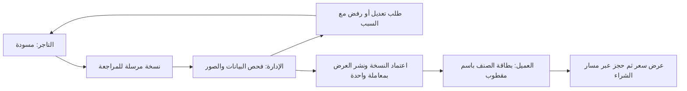
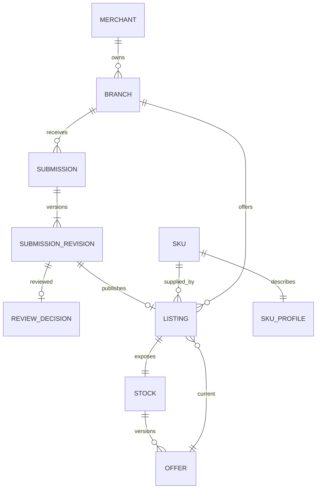

# تصميم أول إضافة جوال واعتماده في الكتالوج

27 نوفمبر 2026 — التصميم الأصلي للكتالوج. نُفذت منه المرحلةA للمسودات والمراجعة الخاصة على codex/catalog-drafts وفق [عقدها](CATALOG_API.md). النشر والضمان وتسعير العميل والربط المالي في الأقسام التالية تبقى مقترحات للمرحلتينB/C، ولا يمثل وجود تصميمها تنفيذًا لها.

## النطاق والمرجع

المخرج المطلوب: تاجر مصرح يضيف جوالًا من فرعه، وتراجعه الإدارة وتنشره، ثم يراه العميل باسم مقطوب. يرتبط بالمهمة09 من EXECUTION_PLAN.md، وبـR01 وR03 وR04 وR08 وR10 من PROJECT_GUIDE.md. ترقيم R في خطة PDF مختلف عن سجل الدليل.

المتطلبات المستمرة: لا سوق أفراد، لا كشف المورد للعميل، عزل الفروع، ولا نشر مستعمل دون فحص وضمان معتمدين. رد الشركة TASK01_2026-11-25.md يتقدم على ترتيب المفاضلة الأقدم. الدليل المحاسبي الذي وفره المستخدم مرجع لفصل ملكية المخزون والتوريد والتسوية، ولا يغيّر تلقائيًا سياسة تشغيل معتمدة.

المقترح لأول تنفيذ: جوال **جديد**، عملة YER، إضافة يدوية، فرع تاجر واحد في كل طلب، وكمية موجبة صحيحة. اللوحيات واللابتوبات والاستيراد والمستعمل والصرف والدفعات المخزنية اللاحقة تتبع مساراتها قبل تفعيلها. هذا تضييق مقترح لأول مسار، وليس إلغاءً لنطاق المهمة09 الكامل.

## نتيجة مراجعة الموجود

| المصدر الفعلي | الموجود اليوم | ما ينقص المسار المطلوب |
|---|---|---|
| purchase.merchant وbranch في schema.sql | تاجر وفرع وربط الملكية | ليسا مسار تهيئة منشأة أو اعتماد تجاري كاملًا |
| purchase.sku | id وname فقط | مواصفات معتمدة وصور وحالة الجهاز وهوية صنف موحدة |
| purchase.stock | صف فريد لكل فرع وصنف، on_hand وheld وallocated | مصدر إضافة الكمية ومرجع الاعتماد، وتحديد الملكية الاقتصادية |
| purchase.offer | stock_id وsupply_yer وrate | مصدر العرض المعتمد ونسخته وحالة إتاحته |
| purchase_api.eligible_offer | قائمة يهيئها المشغل في التجربة | شرط أهلية مشتق من النشر والفرع والكمية والصلاحية بدل الإدخال اليدوي |
| purchase_api.principal والحسابات | دور وتاجر وجلسة وإبطالها | تفويض صريح للفروع؛ دور التاجر وحده لا يثبت الوصول إلى كل فرع |
| quote_handset ومسارات HTTP | شراء من صفوف تجهزها بيانات الاختبار؛ سعر البيع يساوي التوريد في المثال الحالي | قراءة كتالوج حقيقية وربط العروض المنشورة بمولد عرض السعر |

لا توجد حاليًا جداول لمسودة منتج أو مراجعة أو فحص جهاز أو ملفات منتج، ولا endpoints لإضافة المنتجات واعتمادها. النموذج الحالي مرجع لحماية الشراء، وليس كتالوجًا جاهزًا.

الفقرة السابقة خط أساس قبل التنفيذ. أضافت المرحلةA لاحقًا المسودات والنسخ والقرارات والصور الخاصة والتفويض فقط؛ الموجود الفعلي وحالته موثقان في CATALOG_API.md وCATALOG_HTTP.md، ولا يوجد اعتماد نشر فعّال.

## البدائل والاختيار المقترح

| البديل | أثره |
|---|---|
| التاجر ينشئ sku وstock وoffer مباشرة مع علم approved | سريع، لكنه يخلط المسودة بالمخزون القابل للبيع ويصعب حفظ النسخة التي اعتمدت |
| طلب إضافة بنسخة ثابتة، ثم نشر ذري بعد مراجعة الإدارة | يفصل المراجعة عن البيع ويحفظ تاريخ الاعتماد ويمنع زيادة الكمية بتكرار الموافقة؛ **الموصى به** |
| إدارة معلومات منتجات عامة شاملة منذ البداية | أوسع من أول مسار مطلوب، ويؤخر التحقق من إضافة جوال واحد فعليًا |

بطاقة العميل مشتركة لكل صنف، بينما يبقى عرض التاجر ومخزونه داخليين. تُشتق هوية التاجر من الجلسة، ويختار التاجر فرعًا مخولًا فقط. إذا وجد صنف مطابق، تربط الإدارة العرض به بدل إنشاء بطاقة عميل مكررة.

## مسار الإضافة

الحالات المقترحة لطلب الإضافة: draft ثم pending_review، ومنها changes_requested أو rejected أو approved. يستطيع التاجر سحب الطلب المعلق إلى withdrawn. إعادة الإرسال بعد التعديل تنشئ نسخة جديدة؛ الرفض نهائي للنسخة المرفوضة وليس ترخيصًا لتغييرها في الخفاء.

النسخة المرسلة ثابتة. لا يستطيع التاجر تعديل السعر أو الصور أثناء مراجعتها؛ يسحبها ويعدّل مسودة جديدة. الاعتماد يحدد expectedRevision وexpectedVersion. إذا سبق سحبها أو استبدلت نسختها تعاد409 ولا ينشر شيء. التعديل بعد النشر يقدم طلب تعديل مستقلًا؛ تبقى النسخة المنشورة السابقة دون تغيير حتى قبول بديلها.

## الحقول

| المجموعة | الحقول | من يحددها وما القاعدة |
|---|---|---|
| هوية الإضافة | submissionId، merchantId، createdBy، createdAt، version | الخادم؛ merchantId لا يقبل من جسم طلب التاجر |
| الفرع | branchId | يختاره التاجر من فروعه المصرح بها؛ يتحقق الخادم من ملكيته وتفويض حسابه |
| مواصفات الصنف | category=phone، brand، model، storageGb، ramGb، color، condition | يرسل التاجر اقتراحًا؛ الجديد فقط في أول مسار. أي تغيير في خاصية مميزة يعني مراجعة تطابق الصنف |
| المحتوى | suggestedTitle، description، mediaAssetIds | وصف بلا هاتف التاجر أو عنوانه أو إعلاناته؛ تتحقق الإدارة من النص والصور وتختار نسخة عامة منقحة |
| الضمان | warrantyPolicyId، warrantyProviderType | سياسة ضمان معتمدة تختار من قائمة، لا مدة يخترعها النظام. إن لم توجد سياسة مناسبة يبقى الطلب قيد المراجعة |
| التوريد | supplyAmount كقيمة عشرية نصية، currency=YER | سعر توريد موجب في أول مسار. ليس تكلفة شراء التاجر أو سعرًا نهائيًا يفرضه على العميل |
| المخزون الأولي | initialQuantity كعدد صحيح موجب | إعلان كمية افتتاحية لهذا الفرع والصنف، تُفعل مرة واحدة عند الاعتماد. الإضافة لصف مخزون موجود تحتاج مسار توريد/تسوية مستقلًا |
| العمولة | commissionAgreementId، rate، effectiveVersion | من اتفاق التاجر المعتمد في الخادم؛ لا يقبل rate حرًا من التاجر ولا ينشئ اتفاقًا من تلقاء نفسه |
| قرار الإدارة | decision، reason، approvedRevisionId، canonicalSkuId، reviewedBy، reviewedAt | من جلسة الإدارة؛ السبب إلزامي للرفض وطلب التعديل، وربط الصنف يراجعه الخادم |
| حالة الإتاحة | publicationState وownershipType=merchant_owned | الخادم مع قرار الإدارة؛ لا يبدلها العميل أو التاجر في جسم الطلب لتجاوز المراجعة |

مقترحات قيود الإدخال: أطوال محددة للنصوص، رفض الحقول الإضافية، قيم موجبة، مراجع ملفات مملوكة ومكتملة الفحص، وطلب واحد لا يخلط فروعًا. تضبط الحدود الرقمية للصور والنصوص في عقد التنفيذ، ولا تُعرض هنا كقرارات شركة.

فصل التنفيذ أثناء انتظار الشركة: يجوز حفظ مسودة وإرسالها للمراجعة الداخلية مع غياب سياسة الضمان النهائية وقاعدة سعر العميل، وتظهر الاعتماديات الناقصة للمراجع. وصف التاجر لضمانه يبقى اقتراحًا داخليًا. لا يحفظ قرار approved ولا ينشأ مخزون قابل للبيع حتى اكتمال الشروط المعتمدة؛ عدم رد الشركة ليس اعتمادًا افتراضيًا. خطة المراحل في [خطة التنفيذ](../superpowers/plans/2026-11-27-catalog-first-handset.md).

IMEI/Serial ومستند فحص الجهاز بيانات تشغيلية خاصة حين يفعّل مسار المستعمل أو التتبع التسلسلي. لا تعرض في بطاقة العميل. يلزم تصميم قطعة جهاز مستقلة قبل بيع أجهزة مستعملة متفاوتة الحالة تحت الصنف نفسه؛ لا يحل حقل condition وحده هذه المشكلة.

## الجداول والعلاقات المقترحة

أسماء الجداول أدناه تصميم مقترح. تبقى جداول الشراء الحالية ومفاتيح الطلبات والقيود محفوظة.

| الجدول | أهم الحقول والعلاقة |
|---|---|
| catalog.submission | id، merchant_id، branch_id، state، current_revision_id، version، created_by؛ فرع واحد وتاجر مشتق من هويته |
| catalog.submission_revision | id، submission_id، revision_number، proposed_sku_id اختياري، مواصفات/نص/ضمان/توريد/عملة/كمية، created_at؛ نسخة ثابتة لا تتغير بعد الإرسال |
| catalog.review_decision | revision_id، decision، reason، reviewer_identity_id، decided_at؛ قرار نهائي واحد لكل نسخة مرسلة |
| catalog.sku_profile | sku_id يشير إلى purchase.sku، الهوية المعيارية للطراز والخصائص المميزة والحالة؛ تعتمد الإدارة الإنشاء أو الربط بصنف قائم |
| catalog.warranty_policy_version | id، policy_code، version، نص الشروط العامة، جهة الالتزام المعتمدة، private_evidence_ref، approval_state؛ نسخة ثابتة لسياسة حقيقية تقرها الشركة |
| catalog.merchant_terms_version | id، merchant_id، version، commission_rate، warranty_policy_version_id، private_agreement_ref، approved_by؛ شروط توريد/عمولة معتمدة، لا نموذج إدارة عقود كاملًا |
| catalog.listing | id، branch_id، sku_id، stock_id، current_offer_id، approved_revision_id، publication_state، ownership_type، version؛ فريد للفرع والصنف ولمصدر الاعتماد |
| catalog.media_asset | id غير كاشف، owner_identity، private_storage_key، checksum، media_type، processing_state، public_derivative_id؛ ترتبط الصور بالنسخة وصلاحيات مالكها |
| catalog.audit_event | actor، operation، resource، from_version، to_version، request_key، recorded_at؛ يسجل التغيير والقرار داخل نفس المعاملة دون أسرار |
| purchase_api.principal_branch | principal_login وbranch_id؛ تفويض إداري للفروع، مع تحقق من تطابق منشأة الفرع مع هوية التاجر |

الاعتماد لأول عرض فرع/صنف، في معاملة واحدة: قفل الطلب ونسخته، التأكد من pending_review، إعادة فحص صلاحية المدير وحالة التاجر والفرع، ربط/إنشاء الصنف المعتمد، إنشاء stock بالكمية الافتتاحية وheld=allocated=0، إنشاء offer من السعر والعمولة المعتمدين، ثم listing وقرار الاعتماد وسجل التدقيق ونتيجة منع التكرار. الملفات تُعالج قبل المعاملة، فلا ينتظر قفل قاعدة البيانات رفع صورة.

إن وجد مخزون للفرع والصنف بالفعل فلا تضيف الموافقة نفس الكمية فوقه. تعاد409 بمسار الربط/التوريد المطلوب؛ يُصمم تعديل عرض قائم أو استلام كمية جديدة صراحة قبل تفعيله. قيد uniqueness ومصدر اعتماد فريد يحميان من جهازين يعتمدان نفس الإضافة.

المقترح لتعديل عرض قائم لاحقًا: offer جديد ونسخة نشر جديدة دون تغيير stock.on_hand. لا يعاد استعمال initialQuantity لإنشاء رصيد إضافي عند تحديث السعر أو الصور. لا تتغير عروض أسعار العميل أو الطلبات المحفوظة بأثر رجعي.

مراجع الضمان واتفاق العمولة ليست جداول موجودة اليوم. يهيئ المشغل السجلات الموثوقة ونسخها المعتمدة لأول مسار، دون إضافة واجهات لإدارة العقود ضمن هذه المهمة. يشير الاعتماد إلى نسخة شروط التاجر، ولا يُحوّل معدل offer التجريبي وحده إلى عقد شركة معتمد.

## الصلاحيات وعقود API المقترحة

| الإجراء | التاجر | الإدارة | العميل | المندوب/الخدمة |
|---|---|---|---|---|
| إنشاء/تعديل مسودة | له وفي فرع مخول | قراءة للمراجعة | ممنوع | ممنوع |
| إرسال/سحب طلب مراجعة | طلبه فقط وبحالته المناسبة | قراءة | ممنوع | ممنوع |
| قراءة السعر الداخلي والكمية المقترحة والرفض | إضافاته فقط | بصلاحية الكتالوج | ممنوع | ممنوع |
| اعتماد/رفض/طلب تعديل | ممنوع | مدير مخول مع فحص النسخة | ممنوع | ممنوع |
| تغيير اتفاق العمولة | ممنوع من مسار المنتج | مسار اتفاق مالي منفصل | ممنوع | ممنوع |
| قراءة الكتالوج المنشور | منفصلة عن شاشة عروضه | مسموح | الحقول العامة فقط | لا صلاحية كتالوج تمنح تلقائيًا |
| قراءة صورة أصلية أو ملف فحص | مالكها المخول | المراجع المخول | ممنوع؛ نسخة عامة فقط | ممنوع |

المسارات المقترحة: POST /v1/merchant/catalog/submissions، GET/PATCH /v1/merchant/catalog/submissions/{id}، POST .../{id}/submit وwithdraw، GET /v1/admin/catalog/submissions، POST .../{id}/decision، GET /v1/catalog/handsets وGET /v1/catalog/handsets/{skuId}.

تستعمل الكتابات Idempotency-Key مرتبطًا بالهوية والعملية والمورد وبصمة المدخلات، وexpectedVersion/expectedRevision عند تغيير حالة. يعود نفس المفتاح والنية إلى نفس النتيجة، والمفتاح نفسه ببيانات مختلفة409. التحقق من الجلسة والصلاحية يُعاد بعد انتظار قفل الأعمال وحتى عند إعادة نتيجة مخزنة؛ لا تُكشف بيانات اعتماد قديمة لحساب موقوف.

العميل يتلقى قائمة حقول محددة: skuId، الاسم التجاري للمنتج، brand وmodel والمواصفات، condition، الصور العامة، ملخص الضمان، storefrontName=مقطوب، displayPrice.amount/currency وavailability. لا merchantId أو branchId أو offerId أو supplyAmount أو cost أو commission أو IMEI أو مفاتيح التخزين. عنوان البطاقة اسم الجوال، وهوية جهة البيع المعروضة مقطوب.

لا ترسل كمية التاجر الدقيقة أو روابط صور تكشف اسمه أو حسابه. تراجع الصور والعلامات المائية والنصوص وبياناتها الوصفية قبل اشتقاق نسخة عامة؛ إخفاء عمود المورد من JSON وحده غير كافٍ.

## الربط بمسار الشراء

تستبدل تهيئة eligible_offer اليدوية بأهلية مشتقة من listing المنشور، ونشاط المورد والفرع، والكمية، وبوابات المفاضلة المعتمدة. يبقى اختيار المورد في الخادم وبترتيب رد الشركة؛ العميل يرسل skuId ولا يختار merchantId أو offerId.

السعر الظاهر سعر حالي يخرجه نفس مصدر التسعير، ويعاد إصدار عرض سعر العميل عند بدء مساره. عرض الكتالوج لا يحجز كمية. الحجز ما زال15 دقيقة، وتثبيت السعر ساعة عند إصدار عرض العميل وفق المسار الحالي.

quote_handset الحالي يساوي سعر البيع بسعر التوريد؛ هذه فرضية تجربة الشراء، وليست سياسة تسعير عامة. يوصى بحفظ هذا التبسيط لأول مثال فقط بعد اعتماد المالك، أو تصميم قاعدة سعر البيع المنفصلة قبل كتابة API الكتالوج. لا يوضع سعر بيع جديد تلقائيًا من سعر توريد التاجر أو عمولة يرسلها العميل.

أظهرت مراجعة التصميم حالة مهمة: قد يقدم تاجران الصنف نفسه بضمانين مختلفين. المقترح لأول مسار أن يكون ضمان العميل موحدًا ومعتمدًا لكل بطاقة صنف، ولا يدخل المنافسة عليها عرض لا يفي بهذه السياسة. تُحفظ نسخة شروط الضمان مع عرض سعر العميل ثم بند طلبه؛ لا يستبدلها اختيار مورد آخر بصمت. إذا اختارت الشركة السماح بضمانات مختلفة، يلزم عرض خيار واضح للعميل وموافقته قبل إنشاء عرض السعر، بدل دمجها كأنها المنتج نفسه. جهة الالتزام بالضمان وشروطها يجب أن تكون صحيحة ومعتمدة، ولا يفترض التصميم التزامًا ماليًا على مقطوب لم يقر.

مقترح إيقاف العرض: إيقاف عروض الأسعار والحجوزات الجديدة مع حفظ الطلبات والحجوزات السارية ونسخ أسعارها. السحب لأسباب سلامة جهاز يحتاج سياسة مستقلة قبل مسار المستعمل؛ لا يحرر حجزًا مدفوعًا أو يلغي مستحقًا بإخفاء بطاقة فقط. يجب اعتماد أثر الإيقاف على الدفع المتأخر قبل تنفيذ الإيقاف الفعلي.

## الأثر المحاسبي لدليل الحسابات المرفق

الملف الأصلي خاص ويظل خارج المستودع. مراجعة التصنيفات اللازمة أكدت فصل مخزون مقطوب المملوك عن بضائع التجار، وتخصيص تسويات ومستحقات التجار والعمولات المؤجلة والمتحققة. نثبت هنا أثر التصميم فقط، ولا ننسخ دليل الحسابات أو بياناته كاملة.

- أول مسار ملكيته merchant_owned. ظهور مخزونه تشغيليًا في stock لا يجعله أصلًا مملوكًا لمقطوب. إضافة الجوال أو اعتماد عرضه لا ينشئ قيد مخزون مقطوب أو إيرادًا أو عمولة أو مستحق تاجر.
- سعر توريد التاجر ليس تكلفة شراء مخزون مقطوب، ولا تكلفة شراء التاجر. يظل نظام دفعات تكلفة التاجر ومشترياته ضمن المهمة10.
- لا ينشأ مستحق لمجرد الموافقة؛ يستمر حدث الاستحقاق المعتمد عند التسليم. أسعار التوريد والعمولة تحفظ على عرض الشراء وبنده كما في المسار الحالي.
- مخزون مقطوب الخاص مستقبلًا يحتاج دليل انتقال ملكية/سيطرة ودفعات تكلفة واستلام؛ لا يحول التاجر listing إلى platform_owned من حقل يرسله.
- أرقام الحسابات الفعلية وأبعاد التاجر والطلب والدفعة وسياسة الترحيل تحتاج mapping ماليًا معتمدًا. أسماء prototype مثل pending_sales وmerchant_payable وplatform_revenue ليست دليلًا على اكتمال تطبيق الدليل المحاسبي.
- ظهر تعارض بين صلاحية الترحيل في سطر حساب فروق التقريب في الملف وبين قرار الشركة السابق. يبقى القرار السابق موثقًا، ولا نغيره أو نرحّل إلى الحساب تلقائيًا من هذا التصميم؛ يُطلب توضيح المحاسب قبل ربط التقريب بالدليل.

## مثال من الإضافة إلى الظهور

بيانات مصطنعة: جوال جديد، طراز تجريبي، سعة128GB وذاكرة8GB ولون أسود. التاجر أ في الفرع المخول يطلب نشر كمية1 وسعر توريد54,000YER. يحدد الخادم اتفاق عمولة10% الموجود في المثال، وتختار الإدارة سياسة الضمان المعتمدة ومواصفات وصورًا سليمة.

قبل الاعتماد لا يظهر للعميل ولا يدخل قائمة المرشحين. تعتمد الإدارة النسخة1؛ تنشأ كمية (على الرف1، محجوز0، مخصص0، متاح1) مرة واحدة. تكرار الموافقة لا يكرر الكمية. لا قيد مالي ولا مستحق عند هذه الخطوة.

يرى العميل «جوال الطراز التجريبي128GB» وجهة البيع «مقطوب»، بسعر54,000 إذا اعتمد تبسيط المثال، ولا يرى التاجر أ أو عمولته. الحجز يجعل المتاح0 مرة واحدة. بعد الدفع والتسليم وفق المسار السابق، تبقى عمولة المثال5,400 ومستحق التاجر48,600؛ لا يستحقها عند نشر المنتج.

لو أضاف التاجر ب نفس المواصفات من فرعه، تربط الإدارة عرضه بالصنف نفسه، ولا تنشئ بطاقة عميل مكررة. اختلاف السعة أو الحالة يستوجب صنفًا مناسبًا ومراجعة المطابقة؛ لا يدمج الخادم أجهزة مختلفة لأن اسمها النصي متشابه.

## اختبارات القبول المخططة

1. مسودة غير معتمدة لا تظهر في قراءة الكتالوج ولا تدخل quote/create حتى لو عرف العميل skuId.
2. تاجر ب لا يقرأ أو يعدل أو يرفع صورة لإضافة أ؛ وفرع غير مخول مرفوض حتى داخل المنشأة.
3. طلبا اعتماد متزامنان أو فقد الرد ثم الإعادة ينتجان listing واحدًا وكمية افتتاحية واحدة، دون قيد مالي.
4. سحب المسودة أو تغيير نسختها أثناء انتظار اعتماد يقلب نتيجة الاعتماد إلى409 دون مخزون جزئي.
5. إيقاف حساب التاجر/المدير أو تغيير كلمة مروره أثناء انتظار القفل يبطل الطلب والجلسة القديمة ويعيد كل أثر.
6. لا حقول مورد أو عمولة أو معرفات داخلية في DTO العميل أو الصور وروابطها؛ الأصل الخاص غير قابل للتحميل من العميل.
7. لا اعتماد بغياب اتفاق عمولة أو ضمان معتمد أو ملف صورة جاهز. لا يقبل المستعمل في المسار الأول المقترح.
8. إضافة عرض ثانٍ لصنف مطابق لا تكرر بطاقة العميل، وتمنع القيود إنشاء مخزونين لنفس فرع/صنف.
9. تحديث سعر/صورة لا يعيد تطبيق initialQuantity، ولا يغير طلبًا أو عرض سعر محفوظًا.
10. عرض منشور نفد مخزونه لا يصدر حجزًا زائدًا؛ يعاد اختبار عميلين على آخر قطعة عبر API بعد إنشاء المنتج الحقيقي من التاجر.
11. تمر جميع77 حالة الشراء الحالية واختبارات حارس CI، مع حالات الكتالوج الجديدة على PostgreSQL بدور التطبيق. لا تغيير لحجم الحد الأدنى لإخفاء فشل قديم.
12. لا يدخل مورد بضمان مختلف إلى منافسة بطاقة ذات ضمان موحد، ولا يغير تبديل المورد نسخة الضمان التي قبلها العميل في عرض السعر والطلب.

هذه اختبارات مقترحة لهذا التصميم، لم تنفذ. فحص هذه الجولة مستندي ومطابقة للمصادر فقط.

## ما يحتاج اعتمادًا قبل التنفيذ

1. **نطاق أول مسار:** هل نعتمد البدء بالجديد وبالريال اليمني؟ المستعمل يبقى حتى حسم نموذج فحص كل قطعة وشروط الضمان، دون تخفيف شرط الاعتماد.
2. **سعر البيع:** هل يساوي التوريد في أول تجربة كما في المثال الحالي، أم نحتاج من البداية قاعدة سعر بيع مستقلة يحددها مقطوب؟ فرق البيع يحتاج مثالًا ماليًا معتمدًا.
3. **سياسة الضمان:** تحديد أول سياسة متاحة للجوال الجديد وجهتها وشروطها، واعتماد توحيد ضمان بطاقة الصنف بين الموردين كما نوصي، أو السماح بخيارات ضمان ظاهرة يختارها العميل. لا يفترض النظام مدة ضمان أو التزامًا على مقطوب. هذه نقطة تشغيلية من الشركة، ويمكن تجهيز العقود والجداول دون نشر قبل حسمها.

توضيح صلاحية حساب فروق التقريب يطلب من المحاسب عند إعداد mapping المحاسبة، ولا يمنع اعتماد تصميم إضافة الجوال. أما تفويض الفروع، والنسخ الثابتة، ومنع التكرار، وفصل بطاقة العميل عن عروض التجار فهي اختيارات هندسية موصى بها في هذا المقترح، قابلة للمراجعة الآن.
