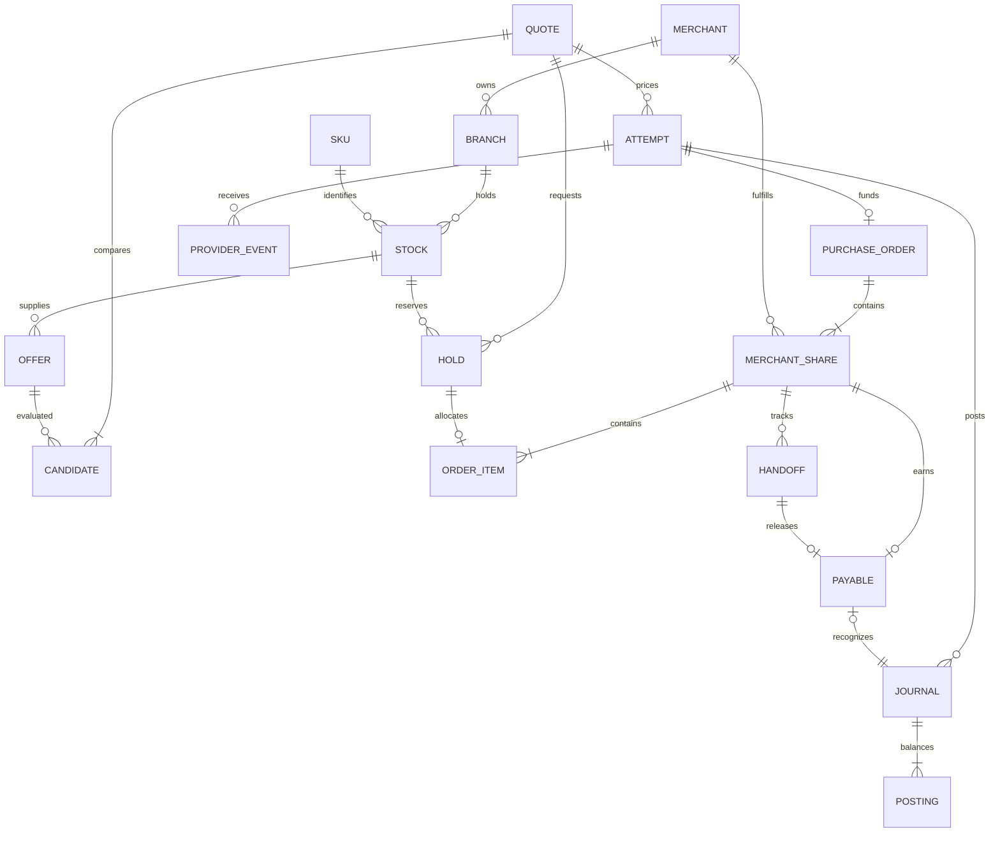

# تصميم قاعدة بيانات أول شراء في مقطوب

تصميم منطقي مقترح لـ PostgreSQL، للمراجعة قبل كتابة الترحيلات. المسار هاتف جديد واحد، دفع مسبق خارجي، تسليم داخل صنعاء. تشمل المتطلبات R01 وR03 وR05 وR09 وR10 وR15. قواعد الاختيار والتوقيت من [محضر اعتماد الشركة](../decisions/TASK01_2026-11-25.md)، وتوقيت تحرير المستحق من [دليل المشروع، القسم 5](../../PROJECT_GUIDE.md).

## الجداول والعلاقات

في الرسم تمثل العلامة المتشعبة جهة السجلات المتعددة. السلة قبل إتمام الشراء يمثلها عرض السعر في هذا المسار ذي الصنف الواحد. ينشئ الخادم حصة التاجر المؤكدة عند التحصيل والتخصيص الناجحين.

| الجدول | المفاتيح والحقول الأساسية والغرض |
|---|---|
| MERCHANT، BRANCH، SKU | معرّف لكل سجل. الفرع يشير إلى التاجر، والصنف يحدد طراز الهاتف وسعته ومواصفاته المعروضة للعميل. |
| STOCK | صف فريد لكل فرع وصنف؛ كمية على الرف، محجوزة مؤقتًا، ومخصصة لطلبات مدفوعة قبل خروجها. المتاح = على الرف − المحجوز − المخصص. |
| OFFER | مرجع المخزون، عملة وسعر التوريد بعد خصم التاجر، نسبة العمولة، وقت بدء صلاحية العرض وانتهائها، وإمكان التجهيز. |
| QUOTE، CANDIDATE | العرض يحفظ العميل، الصنف والكمية وسعر البيع والعملة ووقت الإضافة والانتهاء ومفتاح عملية الشراء. لكل مرشح تحفظ نسخة قيم العرض والصرف والتوريد الموحّد والعمولة المستحقة والموثوقية وحجم العينة والمسافة ونتيجة الأهلية. يحفظ العرض المرشح المختار وسبب الاختيار وإصدار القاعدة. أي إعادة تسعير تنتج نسخة جديدة تتطلب تأكيد العميل وتحافظ على تاريخ الأسعار. |
| HOLD | مرجع العرض وصف المخزون، الكمية، وقت الإنشاء والانتهاء والحالة. يمكن إنشاء حجز بديل بعد تحرير السابق. الحجز النشط الواحد في مثال الصنف لا يُستهلك مرتين. |
| ATTEMPT، PROVIDER_EVENT | المحاولة ترتبط بعرض السعر، وتحفظ المزود ومرجع التحصيل والمبلغ والعملة والحالة ووقت الدفع المثبت لدى المزود. الحدث يحفظ معرّف المزود للحدث ووقت وصوله ونتيجة التحقق؛ قد تصل أحداث مختلفة للعملية المالية نفسها. |
| PURCHASE_ORDER، MERCHANT_SHARE، ORDER_ITEM | طلب رئيسي للعميل، وحصة داخلية لكل تاجر، وبند يشير للحجز المخصص ويجمّد الصنف والكمية وسعر البيع والتوريد والعمولة والصرف. يثبت الطلب منطقة التسليم المطبّقة. لا يظهر معرّف المورد أو تكلفته أو عمولته في استجابة العميل. |
| HANDOFF، PAYABLE | حدث استلام موثق للحصة، بنوعه وتوقيته والمنفذ ومرجع الإثبات. المستحق يسجل الحصة، حدث الاستحقاق، المبلغ والعملة وقيد الإثبات. يوجد مستحق واحد لهذا التسليم الكامل في المسار. |
| JOURNAL، POSTING | رأس قيد له نوع ومصدر أعمال فريد، وبنود مدينة ودائنة تشير إلى حسابات دليل الحسابات. تربط القيود بمحاولة التحصيل وبالمستحق عند تحريره. تسجّل المبالغ بنوع عشري دقيق. |

## معاملة آخر قطعة

1. **اختيار المورد، 10:00.** هاتف واحد في كتالوج العميل. لدى أمل قطعة بسعر توريد 54,000 ريال وعمولة 10%، ولدى نور عرض مؤهل بسعر 55,000 وعمولة 12%. كلتاهما تجتاز بوابة الموثوقية. يفوز عرض أمل بأقل توريد بعد التحويل الموحّد. نفترض في المثال أن سعر البيع يساوي التوريد ولا توجد رسوم أو خصومات. ينتهي عرض العميل عند 11:00. المخزون في فرع أمل (على الرف، محجوز، مخصص، متاح) = (1، 0، 0، 1).
2. **محاولتان عند 10:05.** يحاول عميلان حجز القطعة من الفرع نفسه. في معاملة قصيرة يقفل الخادم صف المخزون، ويتحقق من المتاح ويُدخل الحجز ويحدّث الكمية معًا. يفوز أحدهما فتصبح (1، 1، 0، 0) حتى 10:20. يرى الثاني نفاد القطعة من هذا العرض؛ لا يبدأ له تحصيل عليه. لا يُحتفظ بقفل قاعدة البيانات أثناء انتظار المزود.
3. **دفع 54,000 عند 10:08.** يتحقق الخادم من الإشعار والمرجع والمبلغ والعملة. في معاملة واحدة يسجل النجاح، يحوّل الحجز إلى تخصيص (1، 0، 1، 0)، ويثبت طلبًا وحصة أمل وبندًا وقيدًا متوازنًا. مدين وسيط التحصيل 54,000 ودائن مبيعات معلقة 54,000. يظهر الطلب للعميل، ويظهر للتاجر للتجهيز.
4. **خروج الجوال من الفرع.** عند التسليم الموثق للمندوب تُخفّض الكمية على الرف والمخصصة معًا إلى (0، 0، 0، 0). يُربط حدث التسليم بحصة أمل.
5. **استلام العميل داخل صنعاء.** عند إثبات الاستلام يُنشأ مستحق أمل وقيده في معاملة واحدة. مدين مبيعات معلقة 54,000؛ دائن مستحق التاجر 48,600 ودائن عمولة مقطوب 5,400. في الطلب المسبق خارج صنعاء يكون الحدث المؤهل اعتماد استلام مخزن مقطوب من التاجر.

## حالات الفشل وشروط السلامة

- عند انتهاء 15 دقيقة يحرر العامل الحجز النشط مرة واحدة بمعاملة تقفل نفس صفوف الحجز والمخزون وبنفس ترتيب الأقفال الذي يستخدمه معالج الدفع. إذا وصلت دفعة بعد التحرير يعيد المعالج فحص الكمية ويخصصها ذريًا إن كانت متاحة والسعر صالحًا وقت التحصيل. إذا نفدت، يثبت القبض مقابل حساب 2113 مرة واحدة، ويبدأ مسار البديل أو الاسترداد؛ لا ينشأ مستحق تاجر.
- إذا ثبت التحصيل في الدقيقة 59 ووصل التأكيد في الدقيقة 61، يعتد بوقت المزود وتطبق قاعدة توفر الكمية أعلاه. إذا انقضت الساعة قبل بدء دفع جديد، يعرض السعر المحدّث للتأكيد. عند جهل النتيجة تُطابق المحاولة مع المزود قبل إعادة التحصيل.
- قيود تحقق للمخزون تمنع السالب وتفرض أن مجموع المحجوز والمخصص لا يتجاوز كمية الرف. مفتاح طلب العميل يمنع تكرار نفس الإجراء. يجب أن يعود الحجز والمخزون والعرض المختار والحصة إلى نفس الصنف والفرع والتاجر، عبر مفاتيح مرجعية مركبة أو تحقق مكافئ داخل المعاملة.
- تفرّد (المزود، معرّف الحدث) يمنع إعادة معالجة الرسالة نفسها، وتفرّد (المزود، مرجع التحصيل) ومصدر كل قيد يحميان المال حتى لو تغير معرّف الرسالة. فهرس فريد على مفتاح عملية الشراء يمنع إنشاء طلبين عبر محاولتين ناجحتين؛ إن ثبت قبض ثانٍ فعلي يسجل للمطابقة دون تنفيذ طلب ثانٍ. تكرار إثبات التسليم لا يحرر مستحقًا ثانيًا.
- يمنع ترحيل قيد غير متوازن، وتشتق الأرصدة من البنود المرحلة. يحدد الخادم هوية العميل وعضوية التاجر والصلاحيات من الجلسة، ويتحقق من حق المندوب في الحصة قبل تسجيل الاستلام.
- عند تنفيذ مسار المحفظة يضاف توزيع التحصيل على مصادر التمويل لإعادة كل مبلغ إلى مصدره. المثال الحالي تحصيل واحد خارجي. أسئلة تقييم مورد بلا عينة بعد اليوم الثلاثين، ومجموعة تعادل من ثلاثة موردين، والاسترداد الجزئي تبقى قبل تنفيذ السياسات المعنية.
- اختبارات القبول اللاحقة على PostgreSQL: سباق عميلين، سباق انتهاء الحجز مع التأكيد، تكرار إشعار المزود بمعرّفين، تكرار إثبات الاستلام، ومحاولة تاجر الاطلاع على حصة تاجر آخر. هذا الرسم لا يمثل نتيجة تشغيل تلك الاختبارات.