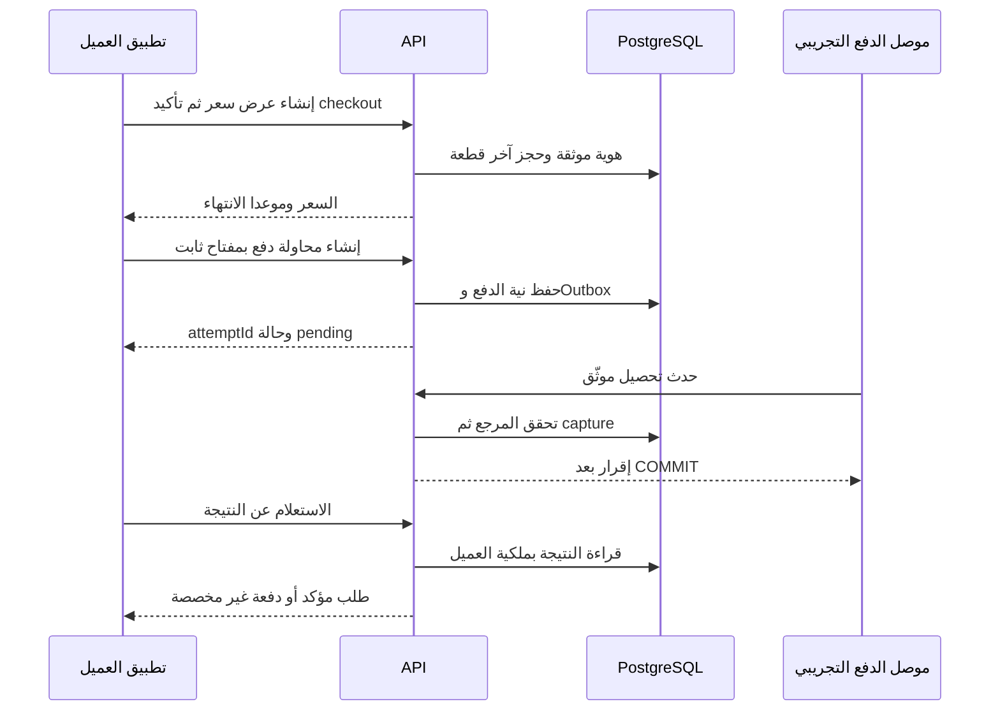

# عقد API لأول مسار شراء

الحالة نُفذ عقد التجربة بتاريخ 26 نوفمبر 2026، ودليل التشغيل والقيود في [تحقق HTTP](../verification/HTTP_PURCHASE.md). يغطي R02 وR03 وR05 وR09 وR10 وR15. مرجع السلوك [محضر الشركة](../decisions/TASK01_2026-11-25.md)، وقاعدة الاختبار [schema.sql](../../db/first_purchase/schema.sql) و[security.sql](../../db/first_purchase/security.sql). إثباتات PostgreSQL في [تقرير المراجعة](../verification/FIRST_PURCHASE_REVIEW.md).

## نطاق أول تطبيق للعقد

شراء هاتف جديد واحد بكمية واحدة، بسعر دفع يساوي سعر التوريد في المثال، وتسليم كامل داخل صنعاء، ودفع خارجي تجريبي. البديل بنفس المبلغ، والاسترداد كامل للدفعة غير المخصصة. التاجر والعميل والمندوب يستخدمون تطبيقاتهم الأصلية المحددة بالدليل. الإدارة توفر بيانات الاختبار والتكليفات مسبقًا.

الأسماء والمسارات والرموز أدناه اختيارات تقنية مقترحة. الحالات المالية وقواعد اختيار المورد والحجز والاستحقاق تتبع قرارات الشركة المسجلة. تشمل مرحلة الربط تنفيذ كل المتطلبات الداعمة المذكورة في هذا العقد واختبارها عبر HTTP مع PostgreSQL.

## هوية الجلسة وربطها بقاعدة البيانات

يرسل التطبيق Authorization: Bearer مع رمز جلسة عشوائي معتم، ويخزن الخادم بصمته وانتهاءه وحالة إلغائه وربطه بهوية المستخدم. يتحقق الخادم من الجلسة وحالة الهوية لكل طلب، بما فيه إعادة نتيجة سابقة. تُحفظ الرموز وبيانات اتصال PostgreSQL في مخزن خاص خارج المستودع.

للتجربة الأولى، يختار الخادم اتصال PostgreSQL محدودًا مربوطًا بهوية session_user الموثقة في principal. تأتي خريطة الهوية وبيانات الاتصال من إعداد موثوق لدى الخادم. يرفض الخادم حقول customer_id وmerchant_id والأدوار والأسعار وحالة الدفع في طلبات العميل. تستخدم مهام الدفع اتصال الخدمة المخصص. تظل بيانات التاجر والمندوب مقيدة بالملكية والتكليف الفعلي عند التنفيذ كما في دوال الصلاحيات.

هذا الربط امتداد لطريقة اتصالات LOGIN التي اختُبرت بالفعل. قبل توسيع تسجيل المستخدمين يلزم تقييم إدارة مجمعات الاتصالات لكل هوية، أو تصميم سياق تفويض موثوق آخر واختباره. يبدأ دخول جلسات التجربة من تجهيز محلي موثوق، ويضاف تسجيل الحسابات واسترجاعها في مهمة خاصة.

## البيانات المشتركة

- المعرّفات نصوص في JSON، وتُحل إلى سجلات يملكها المستخدم على الخادم. يُستخدم معرف عام للدفعة بدل مرجع المزود الخام.
- المبالغ نصوص عشرية مثل "54000.00"، والعملة "YER". يتعامل الخادم مع PostgreSQL numeric دون تحويل الحسابات إلى Number عائم.
- الأوقات UTC بصيغة RFC 3339. يعرض الخادم expiresAt وholdExpiresAt وserverTime، ويحسب التطبيق عداد العرض منهما.
- مخططات الإدخال ترفض الحقول الزائدة. مخرجات العميل تُبنى بقائمة حقول مسموحة تشمل الصنف والسعر والحالة، وتُحجب هوية المورد وسعر توريده وعمولته.
- يربط requestId الطلب بسجل تدقيق منقح. يقتصر التسجيل على المعرفات والنتيجة والتوقيت، وتُحجب أسرار الدفع والرموز والعناوين الكاملة عن سجلات الأعطال.

## مسارات العميل

كل مسار يتطلب جلسة عميل نشطة. id في مسارات checkout يمثل عملية شراء مستقرة مرتبطة بعرض السعر. إعادة التسعير تنتج عرضًا جديدًا يحتاج تأكيد العميل.

| HTTP والمسار | الإدخال | الاستجابة أو السلوك |
|---|---|---|
| POST /v1/quotes | skuId، quantity بقيمة 1، deliveryAddressId | 201، quoteId، sku، amount، currency، expiresAt. يثبت السعر ساعة من الإضافة ويختار الخادم المورد المؤهل. |
| POST /v1/quotes/{id}/checkout | جسم فارغ | 200، checkoutId، quoteId، amount، holdExpiresAt، expiresAt، حالة الحجز. يستدعي reserve بصلاحية العميل بعد التحقق من العنوان والسعر. |
| GET /v1/checkouts/{id} | معرف العملية | 200، السعر والحجز الحاليان وorderId إن وجد، وحالة كل دفعة تخص العملية. |
| POST /v1/checkouts/{id}/payment-attempts | جسم فارغ في التجربة | 202، attemptId، status، statusUrl وتعليمات وسيلة الاختبار. ينشئ نية دفع محفوظة قبل إرسال طلب المزود. |
| GET /v1/payment-attempts/{id} | معرف المحاولة | 200، المبلغ وحالة initiated أو pending أو collected أو failed أو unknown، ومعرف دفعة عند ثبوت التحصيل. |
| POST /v1/checkouts/{id}/receipts/{receiptId}/refunds | جسم فارغ | 202، refundId، receiptId، status بقيمة pending أو confirmed. يثبت طلب رد كامل الدفعة وينشئ مهمة تنفيذ موثوقة. |
| POST /v1/checkouts/{id}/receipts/{receiptId}/replacement | replacementQuoteId | 200، decisionId، receiptId، orderId، replacementQuoteId. يتطلب عرض بديل مؤكدًا بنفس المبلغ ومتوفّرًا عند التخصيص، والتحقق من تطابق receiptId مع مصدر تمويل القرار. |
| GET /v1/checkouts/{id}/receipts/{receiptId}/resolution | معرف الدفعة | 200، قرار unresolved أو refund_pending أو refunded أو replacement_accepted ومعرف العملية المستقرة. |
| GET /v1/orders/{id} | معرف الطلب | 200، الصنف والسعر وحالة التجهيز والاستلام والتسليم. |

رسالة الانتقال للدفع تعرض للعميل حجز الكمية 15 دقيقة وثبات السعر ساعة. إنشاء محاولة دفع جديدة يحتاج عرض سعر ساريًا وحجزًا نشطًا. إذا انتهى الحجز يمكن تجديده على نفس العملية وفق المخزون. تغيّر السعر يحتاج تأكيد عرض جديد قبل أي تحصيل جديد.

الطلب وحالة الدفعة يعرضان كلًا في حقله. قد يكتمل طلب واحد مع بقاء تحصيل زائد منفصل يحتاج استردادًا. تُعرض حالة كل دفعة مستقلة. في المسار الأول يسمح إنشاء البديل عندما توجد دفعة واحدة فقط للعملية. بعد وصول تحصيل زائد يُعاد قرار البديل السابق للدفعة الأصلية فقط، وتتاح معالجة التحصيل الزائد بالاسترداد الصريح بمرجعه. يتحقق الخادم من تطابق receiptId مع replacement.provider_ref حتى عند الإعادة، قبل استدعاء دالة البديل الحالية. تحصيل زائد بعد قبول بديل لا يغيّر القرار السابق.

مثال نتيجة checkout بعد الحجز:

```json
{
  "checkoutId": "101",
  "quoteId": "101",
  "amount": "54000.00",
  "currency": "YER",
  "expiresAt": "2026-11-26T08:00:00Z",
  "holdExpiresAt": "2026-11-26T07:20:00Z",
  "serverTime": "2026-11-26T07:05:00Z",
  "orderId": null,
  "receipts": []
}
```

## التاجر والمندوب والخدمة

| HTTP والمسار | هوية المنفذ | قاعدة البيانات والقبول |
|---|---|---|
| GET /v1/merchant/orders/{id} | عضو تاجر مفوّض | merchant_order، حصة التاجر وصافيها فقط. يرجع المستحق متاحًا عند حدث التسليم المؤهل. |
| GET /v1/courier/orders/{id} | المندوب المكلف | تفاصيل التكليف ومسار الاستلام والتسليم والعنوان المصرح به، مع حجب تكاليف التوريد والمحاسبة. يحتاج DTO ودالة قراءة محدودة. |
| POST /v1/courier/orders/{id}/handoffs | المندوب المكلف | kind إما pickup أو delivered، وproofToken موثّق. تتحقق الخدمة من رمز الإثبات وربطه بالطلب ثم تستدعي record_handoff. |
| POST /internal/payment-providers/{provider}/events | مزود موثّق عبر موصل | تتحقق الخدمة من التوقيع ومرجع المحاولة والمبلغ والعملة ووقت التحصيل. بعدها تستدعي capture أو confirm_unallocated_refund. تكرار حدث موثق يقرّ بقبوله بعد تثبيت أثره. |

ينفّذ العامل release_expired دوريًا، ويطابق محاولات الدفع unknown مع المزود قبل إنشاء تحصيل بديل. يحتاج إخفاق التحقق من المزود رفض الحدث قبل الكتابة، وأي انقطاع بعد الكتابة يُعالج بالمرجع المستقر. يُحتفظ بالمبلغ الوارد غير المخصص في 2113 حتى قرار العميل.

## منع التكرار والتعارض

تقترح عمليات POST من التطبيقات رأس Idempotency-Key. نطاق المفتاح هو الهوية والمسار الدلالي والمفتاح، وتحفظ بصمة الإدخال ومعرف النتيجة والرمز والجسم في قاعدة البيانات داخل معاملة العمل نفسها. تُعاد النتيجة المثبتة لنفس الإدخال؛ إعادة المفتاح بإدخال مختلف تعيد 409. تُفحص صلاحية المستخدم قبل إعادة نتيجة مخزنة.

تظل قرارات الدفعة في قاعدة البيانات هي المرجع عند وصول الاسترداد والبديل بمفتاحين مختلفين. طلب الاسترداد المثبت يحجز قرار الدفعة إلى اكتمال رد المزود، وقبول البديل يخصصها للطلب. القرار المنافس يعيد 409 مع DECISION_ALREADY_COMMITTED ومعرف النتيجة المصرح بعرضها. GET resolution يعرض الحالة الحالية حتى لو كانت الاستجابة الأصلية 202 pending.

إذا انقطع الاتصال قبل COMMIT تزول المحاولة، ويمكن للإعادة أو القرار المنافس أن ينجح. إذا انقطع بعد COMMIT تعود نفس النتيجة عند الإعادة ويُرفض القرار المعاكس. لا تُفتح معاملة قاعدة بيانات أثناء انتظار مكالمة المزود.

إنشاء نية الدفع يقفل checkout داخل المعاملة. إذا كانت هناك محاولة initiated أو pending أو unknown، تُعاد هذه المحاولة حتى لو جاء الطلب بمفتاح مختلف من جهاز آخر، ويُربط مفتاحه بنتيجتها. يدعم ذلك قيد يمنع وجود أكثر من نية دفع نشطة لكل checkout. بعد فشل مؤكد يمكن إنشاء محاولة جديدة؛ وبعد تحصيل فعلي يعرض الخادم حالة الطلب أو خيارات معالجة الدفعة. تُطابق النية المجهولة قبل السماح بأمر تحصيل جديد.

تستخدم أوامر المزود مفتاحًا مستقرًا محفوظًا قبل الإرسال ومعرّف محاولة مستقلًا. يتطلب العامل Outbox يُكتب مع طلب الاسترداد أو نية الدفع، ويعيد إرسال نفس الأمر بعد التعطل. يثبت نجاحه فقط بعد تأكيد المزود أو المطابقة. معرّف حدث المزود ومرجع تحصيله مستقلان عن مفاتيح التطبيقات.

## معالجة HTTP والأخطاء

| الرمز | المعنى المقترح |
|---|---|
| 400 | إدخال غير صحيح أو حقول زائدة |
| 401 | جلسة غائبة أو منتهية أو ملغاة |
| 403 | حساب موقوف أو دور لا يملك تنفيذ العملية |
| 404 | سجل غائب أو خارج ملكية المستخدم |
| 409 | OUT_OF_STOCK أو QUOTE_EXPIRED أو DECISION_ALREADY_COMMITTED أو IDEMPOTENCY_KEY_REUSED |
| 202 | قُبلت عملية خارجية وتحتاج تأكيدًا أو مطابقة |
| 503 | تعذر إتمام العملية مؤقتًا، ويعاد نفس المفتاح بعد الاستعلام عن النتيجة |

يرجع الخطأ code وmessage عربية وrequestId، وقد يحتوي resourceId مصرحًا به لاسترجاع القرار. يتحول فشل اتزان القيد أو خطأ داخلي إلى 500 عام مع مرجع تدقيق، وتُحجب رسالة SQL وتفاصيل الجداول. يعيد PostgreSQL قيد التحصيل الناجح مرة واحدة حتى لو تغيّر معرّف رسالة المزود.

## ما يلزم تنفيذه لدعم العقد

1. مخزن جلسات محمي وخريطة موثوقة لهوية اتصال PostgreSQL. تبدأ هويات التجربة ببيانات مصطنعة.
2. إنشاء عرض السعر وقراءته عبر دوال محدودة، مع التحقق من العنوان والمورد وحفظ تاريخ السعر والصرف. الدالة الداخلية الحالية quote_handset تقارن قائمة مؤهلة مقدمة من التجهيز الموثوق.
3. payment_intent مستقل عن payment لتخزين المحاولة قبل التحصيل، ومعرف عام لكل دفعة، وقراءة حالات checkout/resolution الآمنة. تنفصل محاولة pending أو failed عن إيصال قبض فعلي.
4. سجل Idempotency دائم ومعاملته المشتركة مع كل عملية أعمال، وOutbox للدفع والاسترداد. يتطلب توافق المزود مع إعادة الأوامر والمطابقة اختبارًا مستقلًا.
5. دالة قراءة تكليف المندوب، والتحقق من proofToken، وتدقيق محاولات الرفض. يظل إثبات التسليم شرط إنشاء مستحق التاجر.
6. ترحيلات إصدار قابلة للتطبيق على قاعدة التطوير المستمرة واختبارها على بيانات سابقة، مع عزل اعتماديات الاختبار عن عملية الخادم.

## تسلسل التحقق عند التنفيذ



معايير قبول التنفيذ تشمل شراء آخر قطعة بطلبَي HTTP متزامنين، تكرار الطلبات بمفاتيحها، تكرار إشعارات المزود، قطع الاتصال قبل COMMIT وبعده، تنافس الاسترداد والبديل، وعدم تسريب المورد في DTO العميل، وسحب العضوية أثناء انتظار القفل، وتوازن القيود ومستحق التاجر على PostgreSQL. ثم تُراجع نفس الحقول مع عميل Dart عند ربط تطبيق Flutter.

راجع التصميم مراجع مستقل وقورنت مساراته بالدوال الحالية. أُضيف بعد المراجعة ربط البديل بمرجع الدفعة المقصودة، وتحديد نطاق التحصيل الزائد، وقفل نية الدفع بين جهازين قبل إرسال أمر المزود. فُحصت الروابط المحلية ومثال JSON. التحقق من العقد عبر HTTP يأتي عند التنفيذ.
